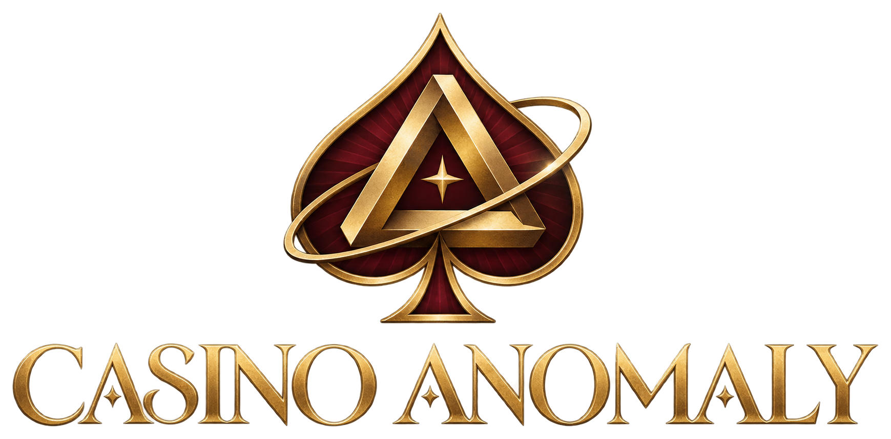
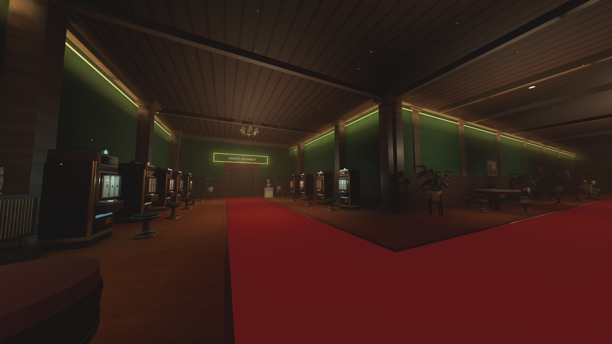
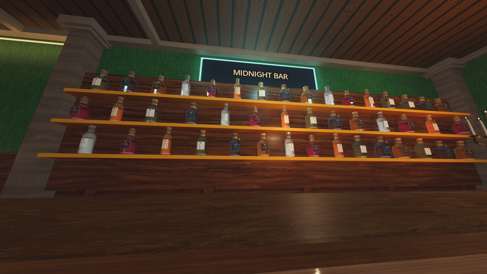
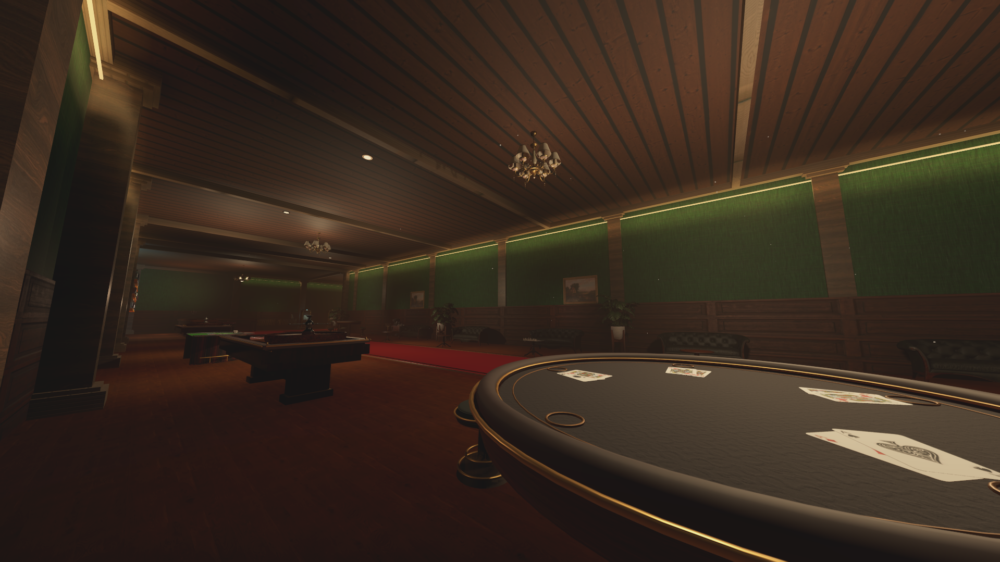
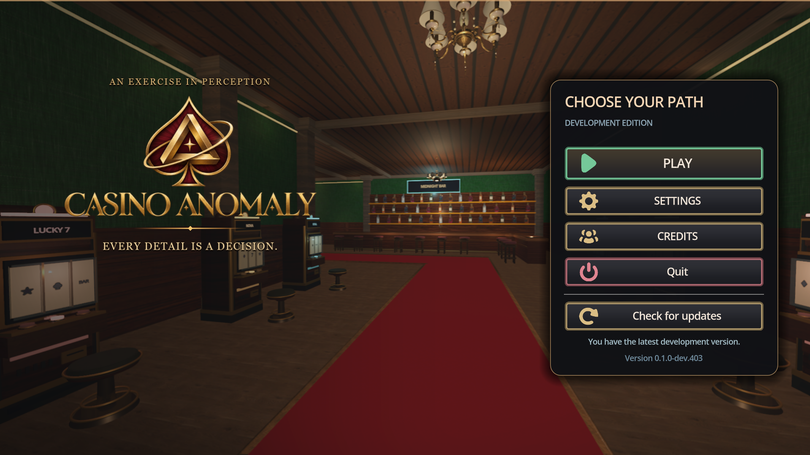

  

<em>AN EXERCISE IN PERCEPTION</em>

<strong>Every detail is a decision.</strong>

  <a href="https://github.com/TeKatz/casino-anomaly/releases/tag/development"><strong>Download the Development Edition for Windows</strong></a>

---

## Welcome to the casino

The lights are on. The tables are ready. The casino is empty.

**Casino Anomaly** is a first-person psychological horror game about observation, memory and doubt. Explore a luxurious, deserted casino that repeats itself as you move from room to room. Familiar surroundings become your only point of reference — and your greatest source of uncertainty.

Something may have changed. Sometimes, nothing has.

## Observe. Decide. Repeat.

Your first casino hall is always normal. Take your time, explore it and remember the details.

At the end of each subsequent hall, two exits await:

- **ANOMALY** — take this exit if something is wrong.
- **NORMAL** — take this exit if nothing has changed.

In Classic Mode, twelve consecutive correct decisions will lead you out. One wrong decision resets your streak.

Not every anomaly announces itself. Some hide in plain sight; others make you question the rules of reality. Pay attention to what you see, what you hear and what you remember.

## More ways to play

- **Classic** — make twelve correct decisions in a row.
- **Endless** — see how far you can go without a single mistake.
- **Nightmare** — face more subtle anomalies with no room for error.
- **Time Trial** — race the clock while mistakes add time penalties.
- **Research** — discover unfamiliar anomalies without streak resets.
- **Expedition** — explore an unusual departure from the familiar casino.

Discover anomalies, build your archive, unlock achievements and progress through your player profile. Graphics, controls, audio and accessibility options let you tailor the experience to your preferences. Some modes must be unlocked through play.

## Inside Casino Anomaly

<table>
  <tr>
    <td width="50%"> <em>The Midnight Bar</em></td>
    <td width="50%"> <em>The gaming lounge</em></td>
  </tr>
</table>

## Play the Development Edition

Casino Anomaly is in active development. The current Windows build is available for playtesting; content and presentation may change as development continues.

**[Download the latest Development Edition](https://github.com/TeKatz/casino-anomaly/releases/tag/development)**

[Installation information](docs/INSTALLATION.md) · [Asset credits](ASSET_CREDITS.md) · [Repository layout](docs/REPOSITORY_LAYOUT.md)

---

<em>Every detail is a decision.</em>

